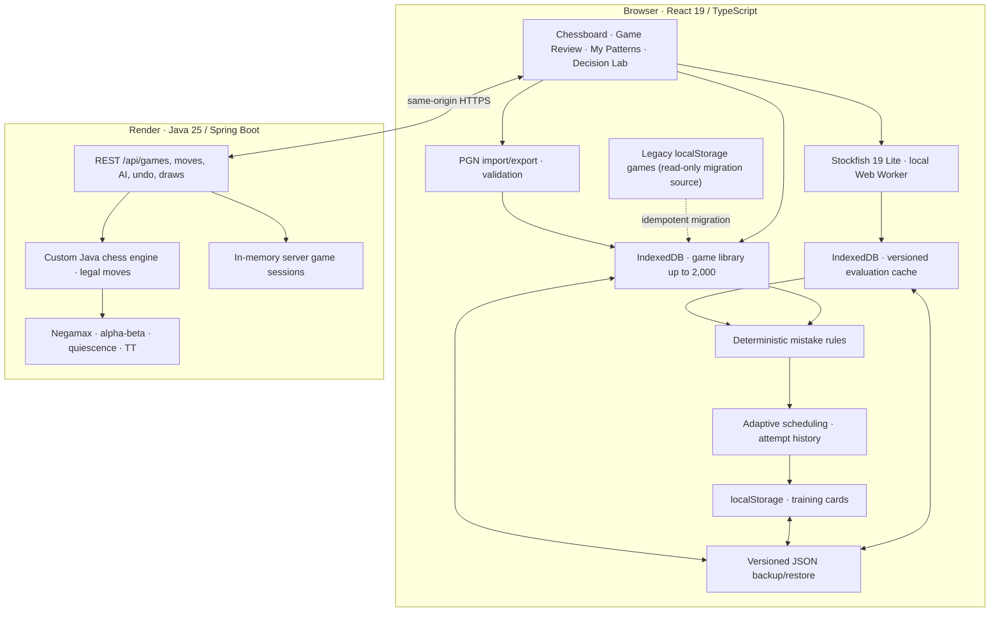

# PlySense v1.0 — System Architecture

PlySense is a **local-first chess improvement platform** with two independent
chess engines for different jobs: the custom Java engine chooses computer
moves; Stockfish 19 Lite evaluates games in the browser. It does **not**
use a hosted LLM or send analysis requests to an external AI API.

## Component diagram

## Three distinct responsibilities

| Responsibility | Component | Invariants |
| --- | --- | --- |
| Play a legal game | Spring Boot + custom Java engine | Check, castling, en passant, promotion, terminal rules; exact published perft checks |
| Review decisions | Local Stockfish Web Worker | Cached positions are keyed by engine version, search depth, hash settings and full FEN; incomplete depth is not treated as verified |
| Identify and practice mistakes | React rules + Decision Lab | Board-supported evidence, count recurrence across **distinct games**, do not infer learning progress from a handful of attempts |

### State and lifetime boundaries

**Server sessions:** The Java backend retains game sessions only in memory;
Render may sleep/restart, and a session ID may stop resolving.

**Saved games:** Every legal server-confirmed snapshot with moves is saved
in the **current browser's IndexedDB**. Older localStorage entries are
migrated non-destructively. Direct review URLs prefer local snapshots.

**Training history:** Decision Lab cards and retained attempts live in
localStorage with a backwards-compatible key; they are not synced to other
devices. The adaptive scheduling heuristic uses previously verified
patterns across distinct saved games.

**Analysis cache:** Cached Stockfish evaluations are browser-local,
versioned and bounded; they can be restored from a JSON backup but are
not a substitute for rechecking in a newer engine version.

**Portable backup:** A versioned JSON export includes saved games,
practice data and durable evaluation results. Restore validates the entire
file and is **additive**, without overwriting existing IDs. Cross-store
commits are not atomic: a partial import can be reported and safely retried.

## Search optimization and evidence

The Java engine does not use Stockfish. It implements iterative deepening,
negamax, alpha-beta pruning, quiescence and a history-aware transposition
table. Perft verifies move generation using published reference positions.

The search optimization reuses legal-move enumeration between status
checking and move ordering. The original algorithm remains available as a
diagnostic reference; both versions must produce identical moves, scores,
node counts, cutoffs and TT hits at the test depths.

[Reproduce and interpret the A/B benchmark](../benchmarks/README.md).

## Tradeoffs and deliberate omissions

- **Offline-first persistence vs. cloud sync:** No accounts, cloud database
  or shared profile. Browser data can be cleared, so a JSON backup matters.
- **Explainable classification vs. generic prediction:** Only three narrow
  tactical patterns with board and engine evidence; a large centipawn loss
  alone is not a reliable description of the cause.
- **Browser-local Stockfish vs. server computation:** Analysis uses the
  user's device CPU, can take multiple passes and may be interrupted.
- **Deterministic practice vs. ML claims:** A transparent scheduling rule
  prioritizes weak patterns; improvement in match outcomes has not been
  established scientifically.
- **Java simplicity vs. peak chess-engine speed:** Whole-game copies and
  history-aware keys are retained to preserve draw correctness and make the
  engine auditable. Future optimization should be guided by profiling,
  not at the expense of FIDE rule correctness.

See [storage migration and backup rules](../storage/README.md) and
[reliability validation matrix](../validation/README.md).
